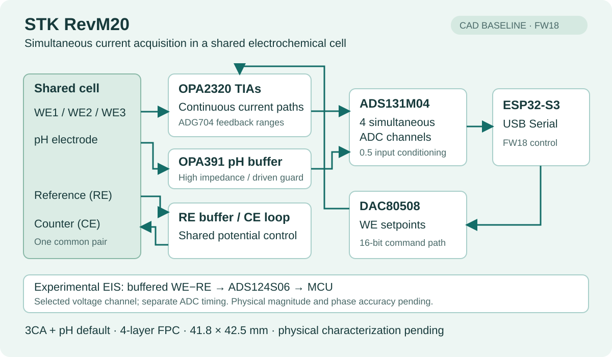

# STK RevM20 sensor front end

**3 current channels + pH · Four-layer FPC · 41.8 × 42.5 mm**

A mixed-signal prototype combining continuous current measurement, a high-impedance pH input and USB-C acquisition.

**Stage:** CAD/source review complete. Manufacturer review and bench validation pending.

## Key design decisions

- **Acquisition and coupling.** Continuous TIAs and simultaneous ADC sampling preserve channel timing. Shared RE/CE saves connections, with electrical and chemical crosstalk left for measurement.
- **Precision and sourcing.** The ADG704 substitution was checked for pin/control compatibility. Leakage, on-resistance, resistor tolerance and reference errors drive the per-range calibration plan.
- **Layout and assembly.** GND/power continuity, high-impedance inputs and USB routing were reviewed. Double-sided FPC assembly requires fixture, reflow and USB mechanical-support review.

## Verification

**CAD evidence:** 0 DRC/ERC violations and 0 unconnected items under the configured checks; BOM/placement matching for 196 fitted parts. [Audit scope and exclusions](evidence/README.md).

**Next:** factory review → USB-only bring-up → dummy-cell accuracy, noise and crosstalk tests. Reset/startup and selected-channel EIS still need physical validation. No measured accuracy is claimed.

## Engineering detail

[Requirements](requirements.md) · [Error budget](error-budget.md) · [Validation plan](validation.md) · [한국어](README.ko.md)

The detailed tables retain 26 requirements, 18 error terms and 25 validation groups. Calculations and evidence labels share one baseline; 22 physical test groups remain unrun.

Design baseline: RevM20 / FW18, 15 October 2026. The [earlier AD5941 toolkit](https://www.charleskim99.com/projects/5_project/) is a separate architecture.

Reproduce the calculations with `python3 docs/projects/stk-revm20/tools/build.py --check`. Regeneration with `--release /path/to/release` verifies the PCB hash before rebuilding the records and summary. Full CAD/firmware and procurement/account data are outside this publication.
