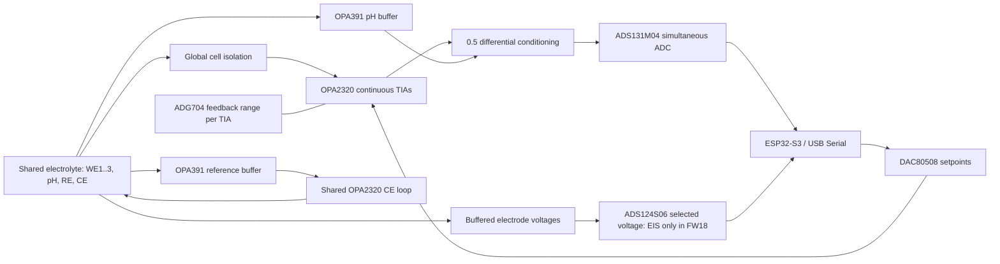

# STK RevM20 electrochemical hardware design

RevM20 is a compact four-layer FPC instrument design for simultaneous three-channel chronoamperometry and pH sensing in a shared electrochemical cell. It uses discrete continuous TIAs, a simultaneous current ADC and a separate selected-channel voltage path for experimental EIS.

**Stage:** CAD and source review completed; manufacturer CAM/placement acceptance and physical characterization pending. No RevM20 measured current accuracy, noise floor, EIS phase accuracy or battery lifetime is claimed.

## Engineering records

- [Requirements and implementation baseline](requirements.md)
- [Preliminary error budget and reproducible calculations](error-budget.md)
- [Validation matrix and measurement record requirements](validation.md)
- [Design evidence and release hashes](evidence/README.md)
- [한국어 요약](README.ko.md)

The website case study and these tables share the same generated dataset. Accuracy targets marked TBD require an explicit requirement before a physical result can receive a qualification pass.

## System architecture



## Design decisions and their consequences

**Continuous paths and shared electrodes.** Separate TIAs and a simultaneous ADC support same-time current acquisition. A shared RE/CE reduces electrode connections, while retaining common-cell electrical and chemical coupling. Global CELL_EN also means independent live per-WE disconnect is outside this revision's scope. The validation matrix separates these limitations from measurable transfer/noise performance.

**A procurement-driven switch substitution.** U21-U24 use ADG704BRMZ-REEL7 in place of unavailable TMUX1104DGSR. Pin mapping, truth table, logic thresholds and control-rail behavior were reviewed. On-resistance, leakage, capacitance and charge injection change the precision and settling problem; per-range calibration and physical residual characterization remain required.

**Compact flex with manufacturing constraints.** The nominal 41.8x42.5 mm,0.20 mm four-layer board has196 fitted parts on both faces. Connected GND/power routing, coverlay/paste geometry and BOM/CPL alignment were audited. Assembly fixtures, reflow sequence, placement acceptance, USB retention and populated-area support remain manufacturing/mechanical work. A flexible board does not establish stretchable-system performance.

## Current evidence boundary

The release records 0 DRC errors,0 warnings and 0 unconnected items under its enabled rules,0 ERC violations and matching202 component references/687 physical pads. Ignored check classes are retained in the evidence summary. These are CAD outcomes. The physical tests in the matrix are NOT_RUN, and quantities without measurements use null values.

Default operation is3CA+pH. Four-current operation requires unpowered physical selector changes. The implemented firmware does not provide CV/DPV, wireless telemetry, automatic battery charging policy or qualified EIS accuracy. Historical AD5941 results on the personal site belong to the earlier architecture.

## Reproduce the documentation

The portable calculations require only Python3:

```bash
python3 docs/projects/stk-revm20/tools/build.py --check
```

To regenerate the hash-bound source index and pages from the matching private release, use `--release /path/to/release`. The script refuses a mismatched PCB hash. Website and Markdown tables are generated from one baseline. The full board source and procurement/account information are outside this publication.
